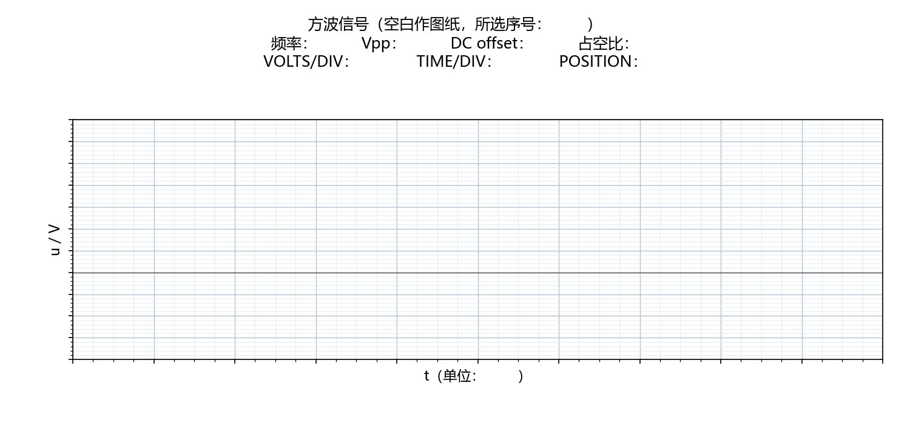
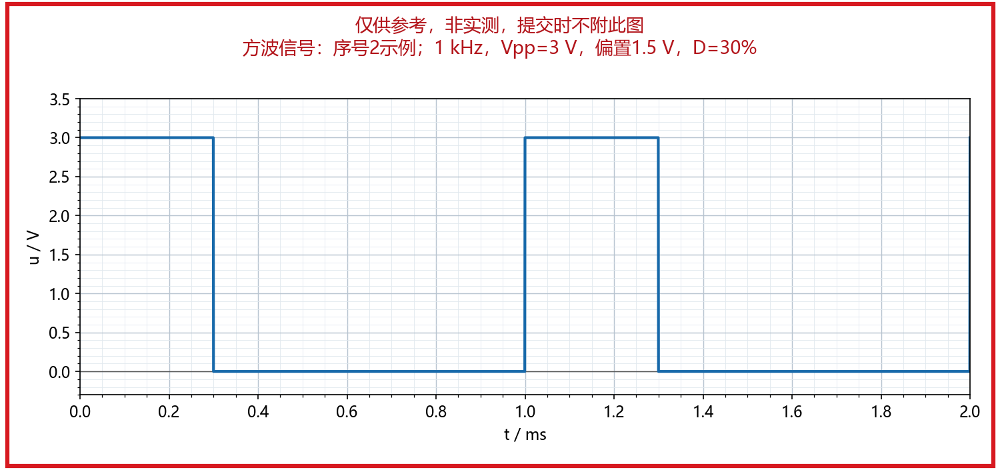

# 安大实验报告模板

一个按教师要求编写实验报告的中文 AI skill：让该做的有据可查，让没要求的测量不进入报告。

适用于根据PPT、实验指导书、报告册照片制作实验报告，补充必要计算、参考波形与待填位置，并逐条对照原要求。**默认输出带图片的Markdown和对应PDF。** 适用于Codex等支持`SKILL.md`、文件生成和绘图工具的助手。

本项目为个人开源工具，不是安徽大学官方模板，不代表学校或教师认可。

## 直接调用

安装后，在支持skill斜杠命令的客户端输入：

```text
/ahu-lab-report-template
```

AI会优先读取当前对话已提供的本次实验课件，执行下面的完整默认流程；不需要再逐条提醒固定栏目、数据留空、红字红框、参考图、MD、PDF和最终核对。没有提供课件时，会先索取必要材料，不能凭空编出一份实验报告。

不支持斜杠命令的客户端，可以直接说“使用 ahu-lab-report-template，根据这份课件写实验报告”。本项目是给AI读取的技能说明，不是输入网址后即可在任何聊天软件独立运行的程序。

## 具体功能

| 功能 | 默认做到什么 |
|---|---|
| 读取实验要求 | 读取课件文字、图片表格、图注及报告要求，查清“全部”“任选”“不做” |
| 固定报告结构 | 严格使用下方五个主栏目，不自行换名称、增删或改变顺序 |
| 控制实验范围 | 该做的全部安排；未要求的测量、逐参数实测表及“不做”的验证不增加 |
| 保留原表 | 表号、行列方向、字段名、顺序、空格位置和数值写法按原表保留，包括`1KHz`、`DC offset`等 |
| 留空真实数据 | 未提供的实测值、仪器型号、实际档位、现象、误差及实验后结论留空 |
| 必要理论计算 | 按原要求写公式、代入和结果，不用空白代替必需计算，也不扩写无关推导 |
| 红色参考值 | 补充参考数值及参考表格中的参考数值用红字，不能混作实测 |
| 整块红框 | 参考文字、表格、图用粗红框整块突出，写明“参考，非实测”；不是只标红标题或加红图标 |
| 空白图与参考图 | 对要求绘制的图，提供空白坐标纸及对应红框参考图；独立图片文件内部也带红框 |
| 正确绘图数量 | 任选一种时只画一个示例，不把示例变成必选项；原要求四组均画时不漏组 |
| 空白表与参考表 | 仅在原要求确需数据表时提供空白表、红色参考值或红框参考表，不借此增加测量项目 |
| 图上作图估算 | 按可核实的方法绘制辅助线，使图、读数及文字解释一致，不擅称教师指定某方法 |
| 文字旁标来源 | 在对应段落、表格及图注后标注课件页码、已读教材章节/页码或来源链接 |
| 核实教材 | 电路实验可参考邱关源原著、罗先觉主编《电路》第6版；实际阅读相关正文，不拿目录或自行推导冒充教材依据 |
| 简洁思考题 | 有要求的思考题放在“分析与讨论”最后，保留题干与条件，只回答所问及必要步骤 |
| 同一正文 | 正文、空白图与红框参考区放进同一个Markdown，不拆成正文版、参考版 |
| 双向交付核对 | 先从要求逐项找成品，再从每个测量栏和实验步骤反查依据，删除没有来源的扩展项目 |
| MD与PDF交付 | 同时给出带图MD、配套图片目录及PDF；检查公式、表格、红色和红框是否实际显示，避免漏图或裁切 |
| 修订与维护 | 用户更正后同步检查所有输出版本；维护skill时同步README、模板、核对项、Git提交和已授权的仓库推送 |

## 输出文件

```text
实验报告.md        正文、空白图位置、红框参考区及来源
实验报告_配图/     Markdown依赖的空白图与参考图
实验报告.pdf       嵌入图片、公式、表格、红字与红框的同版本PDF
```

携带Markdown时需同时带上配图目录，AI可将两者打包；PDF本身不依赖外部图片，方便手机阅读。实测数据仍由实验后填写，理论参考不会变成已经做完实验的证据。

## 效果示例

仅展示一组方波的两张图，分别为空白作图纸及红框参考图，来自本项目实际整理过的报告。参考曲线使用给定参数计算，**不是实测结果**，也不是所有实验都必须选这一组。

**空白作图纸：**



**红框参考图：**



## 核心规则

- 五个报告主栏目固定，按下面的模板填写，不自行增删改名；有思考题时放在“分析与讨论”最后。
- 原表怎么写就怎么保留，包括行列、`DC offset`、`1KHz`等具体写法。
- 区分观察、测量、记录、画图和计算；“观察四种、任选一种画图”不能扩展为四组参数逐项实测表。
- 明确“不做”的项目不安排实施，不虚构结果。
- 固定“红色＝参考”：补充参考数值、表格中的参考数值用红字；参考说明、表格和图片用粗红框整块突出，标注“参考，非实测”。图片内部也保留红框。
- 正文、空白图和红框参考区放在同一个Markdown；实测位置留空，不因参考值增加额外测量栏。
- 没测的数据留空，没有读到指定教材正文就不编教材出处。
- 先按原要求逐项找交付内容，再从成品反查每个测量栏的依据。

## 固定报告栏目

报告采用用户提供的报告册结构，五个主栏目和顺序写死：

1. 实验目的
2. 实验器材
3. 实验原理或相关知识
4. 实验或程序运行结果、数据记录
5. 分析与讨论

模板文件：[assets/report-template.md](assets/report-template.md)。具体实验内容依课件要求填写，模板不预设测量项目。思考题属于第五部分的最后一个小节，不单独增加第六部分；没有思考题时不凭空添加。

## 安装

最方便的方式：**直接把本仓库地址发给AI，让AI下载并安装即可。** 适用于能访问网络、下载文件并安装skill的AI助手。可以直接复制下面这段话：

```text
请下载这个仓库，并将其中的skill安装到你使用的技能目录：
https://github.com/3141317487-dotcom/AHU-Lab-Report-Template
安装后读取SKILL.md，后续按这个skill帮我写实验报告。
```

已安装后想更新，也可以直接告诉AI：“请从这个仓库更新安大实验报告模板skill。”

### 手动安装

将本仓库克隆到助手的skills目录，或复制整个仓库为一个skill文件夹。

```sh
git clone https://github.com/3141317487-dotcom/AHU-Lab-Report-Template.git ~/.agents/skills/ahu-lab-report-template
```

Codex也可放到你的`~/.codex/skills/ahu-lab-report-template/`。让助手重新发现技能后使用。具体加载方式以所用客户端为准。

## 使用示例

通常只需调用skill并提供课件。下面是想显式说明要求时可用的完整说法，这些内容已经是默认规则：

```text
使用 ahu-lab-report-template，根据这份PPT和实验报告册写Markdown。
只做PPT要求的项目。实测数据留空，参考数值用红色。
原表保持不变，空白作图纸和红框参考图都放同一正文。
思考题放在分析与讨论最后，交付前逐条核对原要求。
输出带图片的MD和对应PDF。
```

请提供可读取的课件和报告格式。若方法必须来自某本教材，应提供准确书名版次或可读正文。书目页面不能替代方法所在页。

## 文件结构

```text
SKILL.md                       技能说明
assets/report-template.md      固定五部分的报告模板
assets/examples/               两张效果示例图（空白图、红框参考图）
references/final-checklist.md   人工交付核对清单
scripts/audit_manifest.py       原表、内容覆盖与图片链接检查
evals/evals.json                合成测试提示
LICENSE                        MIT许可证
```

## 私有核对清单与自动检查

将任务要求清单留在工作目录，不放进提交正文。示例结构：

```json
{
  "requirements": [
    {"id": "r1", "source": "PPT第8页", "quote": "计算各组时间常数", "status": "covered", "evidence": "理论时间常数"}
  ],
  "source_tables": ["| 序号 | 1 | 2 |\n|---|---|---|\n| R | 10K | 20K |"],
  "forbidden_text": ["新增实测电源内阻"]
}
```

```sh
python scripts/audit_manifest.py requirements.json report.md
```

检查会验证声明的必做项目有文字锚点、原表按文本保留、禁止项目不存在，以及本地Markdown图片文件存在。**这是辅助检查，不能发现你在清单里漏掉的教师要求，不能验证图像内容、计算正确性或教材出处。** 仍需按`references/final-checklist.md`逐项人工对照。

`evals/evals.json`使用合成材料，覆盖任选范围、原表写法、教材证据不足三类回归问题。已进行一轮有skill/无skill的独立合成小样本检查，两组均通过这三项场景的检查。这说明用例范围内未复现问题，不证明skill优于基线，也不替代真实课件审阅。辅助脚本与固定栏目、默认交付规则另有8项单元测试。

## 工具条件与边界

- 下载与安装需要AI有网络和文件访问能力；`/skill`调用方式由客户端决定。
- 生成图片和PDF需要相应绘图、文档工具。本仓库提供规则、模板和检查脚本，不自带完整AI、教材全文或通用PDF转换程序。缺少工具时应说明具体限制，不能谎称文件已生成。
- 必须给出本次实验材料。没有实际读到指定教材正文就不能声称教材核验完成；没有实测数据不能替用户编造实验结论。
- 原表保持原样，增加红色参考不能成为修改原表或添加未要求测量的理由。
- QQ发送、上传GitHub等外部动作必须另有明确授权，不因调用skill就自动发送报告。此前某次QQ发送请求不会成为之后每次发送的授权。
- 已授权维护的同一仓库继续采用Git提交和推送，更新功能说明与安装包；没有要求时不创建定时更新任务。

## 开源范围

包含通用流程、固定模板、合成测试以及用户授权展示的两张生成示例图。原始课件、学生报告正文、个人资料、教材扫描件、聊天截图和账号凭据不随项目分发。

MIT许可，见[LICENSE](LICENSE)。
